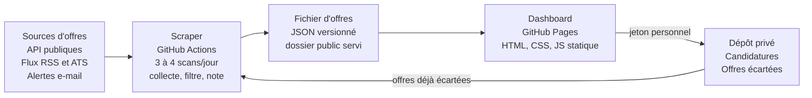

# Mode opératoire — construire un dashboard de veille d'emploi

> **Ce document s'adresse à Claude.** Il décrit comment construire, avec un
> utilisateur, un dashboard personnel de veille d'offres d'emploi, automatisé
> et calibré sur ses critères à lui.

Il ne contient volontairement **aucune règle de filtrage prête à l'emploi** :
les critères d'un chercheur d'emploi ne se transposent pas d'une personne à
l'autre, ils se construisent avec lui (voir Phase 7).

---

## Ce que le projet produit

- un scraper qui interroge plusieurs sources d'offres et produit un fichier JSON ;
- un dashboard web statique affichant les offres retenues et un suivi de candidatures ;
- une automatisation qui relance le tout plusieurs fois par jour, sans intervention ;
- un jeu de règles de filtrage propre à l'utilisateur, affiné par itérations.

L'hébergement et l'exécution sont **gratuits** sur un dépôt public. Aucun
serveur, aucune base de données, aucun appel payant à un modèle : le scan est
un script Python, pas une IA.

**Prérequis côté utilisateur :** un compte GitHub, de la patience pour la
calibration, et selon les sources retenues des clés d'API gratuites et une
boîte e-mail dédiée.

---

## Principes directeurs

1. **La pertinence se calibre, elle ne se devine pas.** Aucune règle écrite
   avant d'avoir vu de vraies offres ne tient. Livrer vite un filtrage
   grossier, puis l'affiner avec l'utilisateur.
2. **Deux niveaux de filtrage, jamais un seul.** L'exclusion dure est réservée
   aux signaux non ambigus ; tout signal interprétable devient une alerte
   visible et l'offre est conservée. Une offre exclue à tort est invisible,
   donc perdue sans recours.
3. **Tout ce qui est personnel vit dans la config.** Seuils, intitulés visés,
   zone géographique : jamais en dur dans le code.
4. **La qualité prime sur le volume.** Le succès se mesure aux offres
   réellement consultées, pas aux offres remontées.
5. **Mesurer ce qu'on écarte.** Chaque exclusion est comptée par motif et
   affichée en fin de scan. Sans ce compteur, un filtre trop large passe
   inaperçu pendant des semaines.

---

## Phase 1 — Entretien de cadrage

**Ne pas écrire une ligne de code avant d'avoir mené cet entretien et fait
valider la fiche de critères par écrit.** C'est la phase la plus rentable.

| Thème | Questions à poser | Ce que ça fixe dans le code |
| --- | --- | --- |
| Poste visé | Quels intitulés acceptes-tu ? Lesquels refuses-tu même s'ils semblent proches ? Quel niveau de séniorité ? | Liste blanche d'intitulés, exclusions de titre |
| Métier réel | Quelles missions veux-tu faire, lesquelles refuses-tu ? Quels outils maîtrises-tu ? | Mots-clés de pertinence, faux positifs à surveiller |
| Géographie | Où habites-tu ? Quel trajet maximum, porte à porte ? Quelles zones sont exclues d'office ? | Calcul d'itinéraire, exclusions de lieu |
| Télétravail | Combien de jours minimum ? Le 100 % distanciel est-il exigé ou souhaité ? Depuis quel pays travaillerais-tu ? | Seuil de télétravail, filtre de zone et de décalage horaire |
| Contrat | Quels types de contrat acceptes-tu ? Lesquels sont rédhibitoires ? | Exclusions de contrat, dans le titre et dans le corps |
| Rémunération | Quel est ton salaire actuel ? En dessous de quel montant refuses-tu ? Quelle cible ? | Plancher dur, pondération du score |
| Exclusions | Des types d'employeurs à éviter ? Des secteurs ? | Liste d'employeurs exclus, amorcée ici, remplie à l'usage |
| Sources | Quels sites consultes-tu ? Reçois-tu des alertes par e-mail ? Quelles API publiques existent dans ton pays ? | Connecteurs à développer et leur ordre de priorité |
| Comptes | As-tu un compte GitHub ? Peux-tu créer une boîte e-mail dédiée et obtenir les clés d'API ? | Secrets à configurer |
| Rythme | Recherche active ou passive ? Combien d'offres par jour veux-tu voir ? | Fréquence du cron, sévérité des filtres |

**Deux piquets à planter d'emblée.** Les exclusions d'employeurs ne se
remplissent pas à l'entretien : elles émergent de la calibration, ne pas
insister. Et demander un *écart acceptable* sur chaque seuil, pas une valeur
unique : un plancher trop net écarte des offres négociables.

**Livrable.** Une fiche de critères écrite, relue et validée par
l'utilisateur, qui devient le fichier de configuration. Si un critère ne peut
pas s'exprimer en valeur vérifiable dans une annonce, il ne sera pas codé : le
noter comme point de jugement humain.

---

## Phase 2 — Architecture de référence

Les secrets — clés d'API, accès à la boîte e-mail, jeton du dépôt privé — sont
injectés au moment de l'exécution et ne figurent jamais dans le dépôt. Rien ne
tourne en permanence : le robot écrit un fichier, le dashboard le lit.

---

## Phase 3 — Mettre en place l'infrastructure

1. **Créer deux dépôts.** Un public pour le code et le dashboard, un privé pour
   les données personnelles. Le public rend les minutes d'automatisation
   gratuites ; le privé garde hors ligne tout ce qui est nominatif.
2. **Activer les Pages** sur le dépôt public, branche par défaut, dossier `docs/`.
3. **Enregistrer les secrets** dans Settings → Secrets and variables → Actions.
   Jamais de clé dans le dépôt, même public.
4. **Écrire le workflow** : un cron plusieurs fois par jour plus un
   déclenchement manuel. Il reconstruit la config à partir des secrets, lance
   le scraper, copie le résultat dans `docs/` et le committe.
5. **Lancer un premier scan manuel** et lire les logs avant même de regarder le
   dashboard.
6. **Ajouter `[skip ci]`** au message de commit du robot, sinon chaque scan en
   déclenche un autre.

**Points de vigilance**

- La branche par défaut est la production : tout ce qui y est fusionné part en
  ligne immédiatement. Travailler par branche et pull request.
- Le push du robot sera rejeté tôt ou tard, la branche ayant avancé entre-temps.
  Prévoir dès le départ une boucle de rebase et réessai dans le workflow.
- Le dashboard est public et son URL est devinable. N'écrire ni adresse, ni
  téléphone, ni CV dans les fichiers servis.
- Les horaires de cron s'expriment en UTC, et l'écart change avec l'heure d'été.

---

## Phase 4 — Le scraper

Un seul fichier Python suffit longtemps. Le pipeline est linéaire :

1. **Collecte** — une fonction par source. Une source qui échoue ne doit jamais
   faire échouer le scan : capturer l'exception, afficher le compte, continuer.
2. **Dédoublonnage** — fusionner les doublons inter-sources *avant* tout
   traitement coûteux.
3. **Enrichissement** — récupérer la description complète quand l'annonce est
   tronquée, puis en déduire télétravail, salaire et contrat.
4. **Filtrage** — une fonction unique renvoyant : exclure ou non, le motif, les
   alertes, les notes.
5. **Scoring** — une note sur 10 et une recommandation.
6. **Export** — un JSON unique, copié dans le dossier servi par les Pages.

### Schéma normalisé d'une offre

Toutes les sources convergent vers cette forme : c'est ce qui rend le filtrage
indépendant de leur origine.

| Champ | Type | Rôle |
| --- | --- | --- |
| `title` | texte | Intitulé ; base du filtrage et du dédoublonnage |
| `company` | texte | Employeur ; souvent absent chez les agrégateurs |
| `location` | texte | Lieu brut, tel que publié |
| `link` | URL | Lien vers l'annonce |
| `source` | texte | Nom de la source ; sert au filtre et au diagnostic |
| `description` | texte | Corps de l'annonce ; support de la plupart des règles |
| `published` | date ISO | Date de publication, pour l'ancienneté |
| `salary_raw` | texte | Salaire tel qu'affiché, parsé ensuite |
| `contract_type` | texte | Type de contrat quand la source le fournit |
| `telework_days` | entier ou `null` | Jours par semaine ; `null` = non renseigné |
| `commute_minutes` | entier ou `null` | Temps de trajet calculé |
| `flags` | liste | Alertes ambiguës ; déclassent l'offre |
| `info_flags` | liste | Notes affichées qui ne déclassent pas |
| `score` | 0 à 10 | Note calculée |
| `recommendation` | énumération | À postuler, à revoir, à écarter |

Distinguer soigneusement `null` (non renseigné) de `0` (présentiel confirmé) :
selon la sévérité voulue, ces deux cas appellent des traitements opposés.

---

## Phase 5 — Intégrer les sources

Commencer par deux ou trois sources qui marchent, pas par dix à moitié.

| Type de source | Effort | Fiabilité | Remarque |
| --- | --- | --- | --- |
| API publique officielle | faible | haute | Souvent nationale et gratuite sur inscription. À privilégier. |
| API d'agrégateur | faible | moyenne | Quotas, et annonces parfois republiées en double. |
| Flux RSS | très faible | variable | Contenu souvent tronqué : prévoir l'enrichissement. |
| API interne d'un site | moyen | haute | Lisible dans les requêtes réseau du site. Peut changer sans préavis. |
| ATS de pages carrière | moyen | haute | Idéal pour une liste d'employeurs ciblés. |
| Alertes e-mail | élevé | haute | Seule voie vers les sites sans API. Boîte dédiée, parfois un parseur par expéditeur. |

### Sources concrètes, confirmées en production

Ces sources ont été effectivement interrogées et exploitées sur un projet de
ce type. Elles constituent un point de départ, pas une liste à jour : vérifier
endpoints, quotas et conditions avant de coder.

| Source | Type | Portée | Accès |
| --- | --- | --- | --- |
| France Travail | API | France | OAuth, inscription gratuite |
| Adzuna | API | une vingtaine de pays | `app_id` + `app_key` gratuits |
| The Muse | API | international | clé gratuite, volume modeste |
| Welcome to the Jungle | RSS + moteur interne | France, Europe | sans clé |
| Remotive | API | 100 % télétravail | sans clé |
| Jobicy | API | 100 % télétravail | sans clé |
| RemoteOK | API | 100 % télétravail | sans clé |
| We Work Remotely | RSS | 100 % télétravail | sans clé |

**Pages carrière (ATS).** Cinq ATS couvrent une grande part du marché :
**Greenhouse, Lever, SmartRecruiters, Ashby, Workable**. Chacun expose un
endpoint public interrogeable avec l'identifiant de l'entreprise. C'est la
meilleure voie pour surveiller une liste d'employeurs ciblés, et elle
fonctionne dans tous les pays.

**Alertes e-mail.** Parsage confirmé pour **LinkedIn, Indeed, HelloWork,
Cadremploi, Meteojob, JobLeads**. La plupart se traitent avec un parseur
générique qui suit les liens d'offres ; certains expéditeurs imposent un
parseur dédié.

**Calcul des trajets.** **IDFM PRIM** (Île-de-France, gratuit), **Navitia**
(France et international), **Google Maps** (payant au-delà d'un quota). À
n'activer que si l'utilisateur a un critère de trajet.

**Hors de France.** Chercher l'équivalent de deux catégories seulement : le
service public de l'emploi national, qui expose souvent une API ouverte, et
l'API de transport régionale pour les trajets. Les cinq ATS et les plateformes
100 % télétravail sont internationaux et fonctionnent tels quels.

> **Vérifier avant d'intégrer.** Sur ce projet, le flux RSS d'Indeed ne
> renvoyait plus aucune offre alors qu'il était toujours documenté. Toujours
> confirmer qu'une source remonte réellement des annonces avant de lui
> consacrer du code.

### Méthode d'intégration — valable pour toute source

**Ne jamais écrire un parseur à l'aveugle.** C'est l'erreur la plus coûteuse.

1. Écrire un diagnostic jetable qui affiche la **donnée réelle** : structure du
   document, noms exacts des champs, valeurs effectivement présentes.
2. L'exécuter là où vivent les accès (dans l'automatisation si les identifiants
   sont des secrets).
3. Écrire le parseur sur cette observation, jamais sur une supposition.
4. Le tester sur un échantillon réel reconstitué, avec des assertions.
5. Supprimer le diagnostic une fois le parseur en place.

### Alertes e-mail

Utiliser une boîte dédiée, jamais la boîte personnelle, et y faire suivre les
alertes. Viser le dossier qui contient **tous** les messages plutôt que la
boîte de réception : sinon tout ce qui est classé ou archivé automatiquement
est invisible. Prévoir un inventaire périodique des expéditeurs présents pour
vérifier qu'aucun type d'alerte n'est ignoré.

### Quand abandonner une source

Si ses liens n'aboutissent pas sur l'annonce, si elle double systématiquement
une autre source, ou si son bruit dépasse son apport. Le coût d'une mauvaise
source n'est pas le code : c'est l'attention de l'utilisateur.

---

## Phase 6 — Le moteur de filtrage

| Niveau | Critère d'emploi | Effet sur l'offre |
| --- | --- | --- |
| Exclusion dure | Signal non ambigu et vérifiable | Disparaît ; le motif est compté |
| Alerte | Signal réel mais interprétable | Reste, badge visible, passe en « à revoir » |
| Note | Information utile qui n'est pas un défaut | Reste, badge neutre, ne déclasse pas |

**La règle d'or : dans le doute, une alerte, jamais une exclusion.** Une offre
signalée coûte dix secondes de lecture ; une offre exclue à tort est perdue
sans que personne ne le sache.

**Ordre des tests.** Du moins coûteux au plus coûteux, et du plus général au
plus spécifique. Conséquence : le premier filtre qui frappe masque les suivants
dans les statistiques, donc un motif à zéro ne prouve pas que la règle est
inutile.

**Bascules de configuration.** Passer d'une recherche active à une veille
passive doit être un changement de valeur, pas de code.

**Observabilité.** Compter les exclusions par motif et les afficher triées en
fin de scan. C'est le premier endroit à regarder quand l'utilisateur trouve le
dashboard vide.

**Le score n'exclut jamais.** Il ordonne. Garder séparées la décision binaire,
qui se discute, et la note, qui se règle.

---

## Phase 7 — La boucle de calibration

C'est elle qui transforme un agrégateur générique en outil personnel, et c'est
la partie que personne ne peut sauter. Compter plusieurs cycles étalés sur
quelques semaines.

1. L'utilisateur parcourt les offres remontées et note, offre par offre, celles
   qui n'auraient pas dû apparaître — **et pourquoi, dans ses mots**.
2. Il transmet ces notes dans un document daté et versionné (calibration v1,
   v2, v3…).
3. Claude trie chaque remarque selon le tableau ci-dessous.
4. Claude code ce qui est codable, et dit clairement ce qui ne l'est pas.
5. Un scan de vérification confirme l'effet, chiffres à l'appui.
6. On recommence au cycle suivant.

| Catégorie | À quoi ça ressemble | Traitement |
| --- | --- | --- |
| Codable en exclusion | Un fait vérifiable et non ambigu dans l'annonce | Nouvelle règle dure, avec son motif compté |
| Codable en alerte | Un signal réel mais interprétable | Nouveau badge ; l'offre reste visible |
| Non codable | Un jugement qui dépend du contexte, ou d'informations absentes de l'annonce | Le dire franchement, ne rien simuler |

**Règles de conduite pour Claude**

- Ne jamais coder une règle qu'on ne sait pas tester. Écrire un cas de test par
  règle avant de fusionner.
- Vérifier l'effet réel après chaque lot : nombre d'offres, répartition, motifs
  déclenchés. Rapporter des chiffres, pas une impression.
- Énoncer ce qui n'a pas été codé et pourquoi. Une calibration honnête vaut
  mieux qu'une calibration complète en apparence.
- Repérer les répétitions : si l'utilisateur revient trois fois sur le même type
  d'offre, la règle existante est mal placée, pas insuffisante.

La calibration est terminée quand un cycle ne produit plus que des remarques
non codables.

---

## Phase 8 — Le dashboard et le suivi

Du HTML, du CSS et du JavaScript sans dépendance, servis en statique. Pas de
build, pas de framework : ce dashboard doit rester modifiable dans deux ans,
par quelqu'un qui n'a pas écrit le code.

Deux onglets suffisent. **Offres** : la liste filtrable, avec la note, les
badges et deux actions, suivre et écarter. **Candidatures** : un tableau par
statut, alimenté depuis le premier onglet.

Filtres côté navigateur à prévoir : recherche texte, source, ancienneté, note
minimale, salaire, critères personnels de télétravail et de trajet, et un
interrupteur pour masquer les offres signalées.

| Donnée | Où elle vit | Pourquoi |
| --- | --- | --- |
| Offres | JSON public, régénéré à chaque scan | Produit par le robot, jamais édité à la main |
| Candidatures et offres écartées | Dépôt privé, synchronisé depuis le navigateur | Données nominatives, à tenir hors du dépôt public |
| Préférences d'affichage | Stockage local du navigateur | Propres à l'appareil |
| Jeton d'accès au dépôt privé | Stockage local uniquement | Ne doit jamais être commité |

**Synchronisation.** Un jeton à portée restreinte, saisi une fois par appareil
et conservé localement, suffit à lire et écrire dans le dépôt privé. Côté
scraper, retirer au scan suivant les offres déjà écartées.

**Piège à connaître.** La clé qui identifie une offre écartée doit être stable :
l'URL ne l'est pas chez certains agrégateurs, qui la régénèrent à chaque scan.
Préférer intitulé + employeur normalisés. Mais une correspondance trop souple
masque des offres légitimes, surtout quand l'employeur est absent : exiger
alors un second signal concordant plutôt que de considérer l'entreprise
inconnue comme compatible avec tout.

---

## Pièges à éviter

Dix erreurs rencontrées en conditions réelles. Chacune a coûté du temps ; les
connaître le rend gratuit.

1. **Ne jamais calculer le coûteux avant d'avoir filtré.** Un appel externe
   lancé sur toutes les offres brutes finit en limitation de débit et en scan
   interminable. Filtrer d'abord, enrichir ensuite. Vérifier au passage que la
   donnée coûteuse n'entrait dans aucune exclusion.
2. **Ne jamais écrire un parseur sans avoir vu la donnée réelle.** La structure
   supposée d'un e-mail ou d'une page est fausse une fois sur deux.
3. **Se méfier des listes d'autorisation trop larges.** Un mot générique placé
   dans une liste « accepter si » peut court-circuiter tout le test qui suit.
   Toujours tester les cas qui doivent être **rejetés**.
4. **Un identifiant d'offre peut vivre dans la query-string, pas dans le
   chemin.** Tronquer une URL à son chemin pour dédoublonner écrase alors
   toutes les offres d'une source en une seule.
5. **Les URL contenues dans du HTML sont encodées.** Décoder les entités avant
   de lire un paramètre ou de stocker le lien.
6. **Un champ structuré prime toujours sur le texte libre.** Quand une source
   expose un champ dédié pour le contrat ou le télétravail, le lire plutôt que
   de le deviner depuis la description.
7. **Les acronymes courts sont des pièges multilingues.** Trois lettres en
   majuscules peuvent être un mot courant dans la langue de l'utilisateur.
8. **L'ordre des filtres biaise les statistiques.** Un motif à zéro signifie
   souvent qu'un filtre antérieur a tout absorbé.
9. **Savoir abandonner une source.** Celle dont les liens n'aboutissent jamais
   sur l'annonce ne se répare pas par un contournement : elle se retire.
10. **La branche par défaut est la production.** Travailler par branche et pull
    request, et vérifier après fusion plutôt qu'avant.

---

## Exploitation et checklist

**Coût : nul.** Minutes d'automatisation gratuites sur un dépôt public,
hébergement gratuit, API gratuites dans leurs quotas.

**Cadence.** Trois à quatre scans par jour couvrent largement le rythme de
publication des annonces.

**Durée d'un scan.** Dominée par les appels externes d'enrichissement. Si elle
dépasse la demi-heure, le coupable est presque toujours un calcul fait trop tôt
dans le pipeline.

**Maintenance courante**

- Relire le compteur de motifs après chaque changement de règle.
- Inventorier périodiquement les expéditeurs d'alertes.
- Surveiller les sources qui tombent à zéro offre : une API interne qui change
  sans préavis, c'est un signal, pas un hasard.

**Deux modes de fonctionnement.** En recherche active : seuils souples, plus de
sources, on accepte du bruit. En veille passive : seuils stricts et intitulés
restreints, le dashboard reste vide la plupart du temps — et c'est le
comportement correct, il sert d'alerte, pas de flux.

### Checklist de livraison

- [ ] Fiche de critères validée par écrit avec l'utilisateur
- [ ] Deux dépôts créés, Pages actives sur le public
- [ ] Secrets configurés, aucune clé dans le dépôt
- [ ] Workflow cron et déclenchement manuel, avec `[skip ci]` et boucle de rebase
- [ ] Au moins deux sources fonctionnelles
- [ ] Compteur de motifs d'exclusion affiché en fin de scan
- [ ] Un cas de test par règle de filtrage
- [ ] Dashboard servi et filtres opérationnels
- [ ] Suivi de candidatures synchronisé, jeton jamais commité
- [ ] Premier cycle de calibration effectué
- [ ] Aucune donnée personnelle dans le dépôt public
